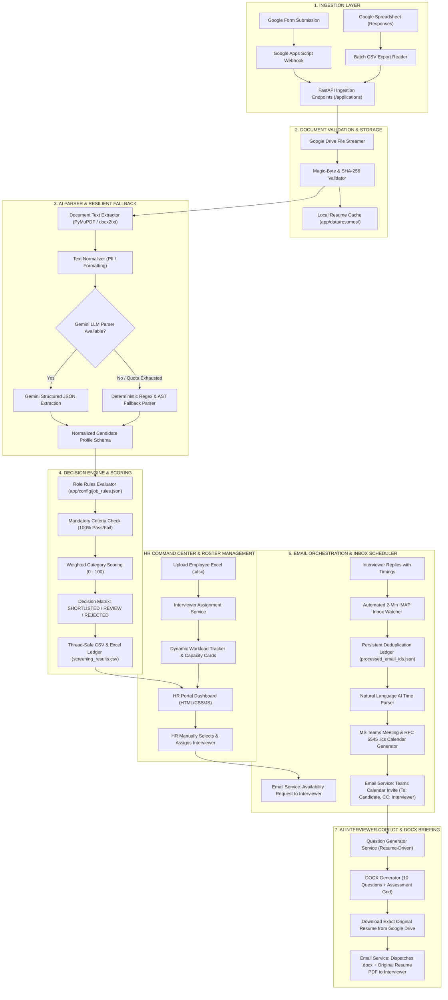

# GWC DATA.AI Enterprise Recruitment & Interview Automation Platform
## Comprehensive Technical Architecture & Engineering Documentation

---

## 1. Executive Summary & Solution Overview

The **GWC DATA.AI Enterprise Recruitment Platform** is an autonomous, end-to-end talent acquisition and technical interview orchestration engine. It transforms traditional, manual hiring bottlenecks into an automated, deterministic, and AI-assisted workflow:

1. **Ingests** candidate applications and resume documents seamlessly from 
Account credentials.
2. **Extracts, Validates, and Parses** complex multi-page PDF/DOCX resumes using a dual-engine parser (Google Gemini LLM + High-Speed Deterministic Regex/AST Fallback).
3. **Screens and Grades** candidates against role-specific mandatory qualifications and weighted scoring rubrics across specialized domains (*AI/ML Engineer*, *Full Stack Developer*, *Data Analyst*).
4. **Facilitates Manual HR Interviewer Assignment** with real-time domain filtering and live interviewer capacity tracking.
5. **Orchestrates Interview Scheduling**:
   - Dispatches branded availability requests to technical interviewers.
   - Listens to interviewer reply emails via a background 2-minute IMAP Inbox Watcher.
   - Extracts free-form natural language timings with an AI/NLP Time Parser.
   - Automatically provisions unique Microsoft Teams meeting links and standard RFC 5545 `.ics` calendar files.
   - Dispatches confirmation invites routing headers correctly: **From: HR Recruiter**, **To: Candidate**, **CC: Interviewer**.
6. **Interviewer Copilot & Question Generator**:
   - Synthesizes 10 bespoke technical interview questions tailored specifically to the candidate's resume projects and claims.
   - Generates a GWC-branded Word Document (`.docx`) with evaluation check-boxes and scoring rubrics.
   - Automatically downloads the candidate's original resume from Google Drive and attaches both files to the interviewer's briefing email.
7. **Dynamic Employee Roster Upload**:
   - Allows HR to upload custom employee roster Excel files (`.xlsx`), dynamically rendering interviewer capacity cards and dropdowns.

---

## 2. End-to-End System Architecture



---

## 3. Core Functional Modules

### 3.1 Document Ingestion & Google Drive Integration
* **File:** [`app/services/google_drive.py`](file:///e:/New%20folder%20%282%29/GWC/HR_workflow/app/services/google_drive.py)
* **Design Rationale**: Traditional Google Drive integrations require complex GCP Service Account JSON keys and domain-wide delegation. GWC's implementation uses direct HTTP streaming endpoints (`https://drive.google.com/uc?export=download&id={file_id}`) with confirmation token handling.
* **Format Detection**: Inspects initial magic bytes (`%PDF` for Adobe PDF, `PK\x03\x04` for Microsoft Word DOCX) to ensure corrupt or non-binary HTML redirects are intercepted.

---

### 3.2 AI Resume Parser & Deterministic Fallback Architecture
* **Files:** [`app/services/resume_parser.py`](file:///e:/New%20folder%20%282%29/GWC/HR_workflow/app/services/resume_parser.py), [`app/services/document_extractor.py`](file:///e:/New%20folder%20%282%29/GWC/HR_workflow/app/services/document_extractor.py), [`app/services/resume_normalizer.py`](file:///e:/New%20folder%20%282%29/GWC/HR_workflow/app/services/resume_normalizer.py)
* **Primary Engine (`GeminiResumeParser`)**:
  - Leverages Google Gemini models to extract structured JSON matching the `CandidateProfile` Pydantic schema: Contact Details, Education, Experience History, Projects, and Core Technical Skills.
  - Enforces temperature = 0.0 for strict factual consistency without generative hallucination.
* **Deterministic Fallback Engine (`FallbackResumeParser`)**:
  - Automatically activated if API keys are missing, network connectivity is lost, or LLM rate limits (HTTP 429) are encountered.
  - Employs regex pattern matching, section boundary segmentation, keyword dictionaries, and date arithmetic to extract experience and skills locally.
  - **Guarantees 100% pipeline uptime and zero unparsed candidate submissions.**

---

### 3.3 Rule-Based Decision Engine & Dynamic Weighted Scoring
* **Files:** [`app/services/decision_engine.py`](file:///e:/New%20folder%20%282%29/GWC/HR_workflow/app/services/decision_engine.py), [`app/config/job_rules.json`](file:///e:/New%20folder%20%282%29/GWC/HR_workflow/app/config/job_rules.json)
* **Screening Philosophy**: The LLM is strictly isolated to data extraction; it **never** makes hiring decisions. All screening decisions are executed by the deterministic Decision Engine.
* **Evaluation Pipeline**:
  1. **Mandatory Criteria Check**: Zero-tolerance boolean rules (e.g., minimum experience years, mandatory degree fields, core prerequisite skills). If any mandatory requirement fails, the candidate is automatically assigned `REJECTED` with a specific audit reason.
  2. **Weighted Category Scoring (0 to 100)**: Evaluates technical skill competencies, framework proficiency, cloud platforms, and project depth according to customized category weights.
  3. **Threshold Classification**:
     - $\ge 75.0$: `SHORTLISTED`
     - $50.0 - 74.9$: `HR_REVIEW`
     - $< 50.0$: `REJECTED`
  4. **Selection Reason Generation**: Automatically generates natural language explanations (*"Selected for AI Engineer: Satisfied mandatory qualifications, high scoring in GenAI/RAG (92/100)..."*) written directly to the ledger.

---

### 3.4 Interviewer Roster Management & Dynamic Workload Tracker
* **Files:** [`app/services/interview_assignment_service.py`](file:///e:/New%20folder%20%282%29/GWC/HR_workflow/app/services/interview_assignment_service.py), [`app/data/interviewers.json`](file:///e:/New%20folder%20%282%29/GWC/HR_workflow/app/data/interviewers.json)
* **Initial State**: Starts in a clean **Empty State** (`No Technical Interviewers Uploaded Yet`) until HR uploads the employee roster.
* **Excel Roster Import**:
  - Parses uploaded `.xlsx` / `.csv` files containing `Employee ID`, `Employee Name`, `Department`, `Designation`, and `Email`.
  - Normalizes departments to domain specialization keys (`AI_ENGINEER`, `FULLSTACK_DEV`, `DATA_ANALYST`).
* **Live Capacity Aggregation**:
  - Dynamically calculates:
    - $\text{Total Load} = \text{Meetings Fixed} + \text{Meetings Pending}$
    - Status badges: `🟢 Available` (0 assigned) vs. `🟡 X Assigned`.
* **Domain-Filtered Assignment**: Candidate assignment dropdowns in the database table dynamically filter interviewers so only technical leads matching the candidate's applied domain are selectable.

---

### 3.5 Automated 2-Minute Gmail IMAP Watcher & Persistent Deduplication
* **File:** [`app/services/inbox_watcher_service.py`](file:///e:/New%20folder%20%282%29/GWC/HR_workflow/app/services/inbox_watcher_service.py)
* **Scheduler**: Initialized in FastAPI's `lifespan` context, executing asynchronous background syncs every 120 seconds.
* **IMAP Sequence Optimization**:
  - Queries `INBOX` message count and fetches strictly the latest sequence range (`max(1, total - 15) : total`), completing scans in **< 0.3 seconds** without downloading the full inbox history.
* **Anti-Loop Persistent Deduplication**:
  - Tracks unique email `Message-ID`s in [`app/data/processed_email_ids.json`](file:///e:/New%20folder%20%282%29/GWC/HR_workflow/app/data/processed_email_ids.json).
  - Enforces state guards (`interview_status != 'MEETING FIXED'`) to ensure that calendar invitations and question kits are dispatched **strictly once**.

---

### 3.6 Natural Language AI Time Parser & RFC 5545 Calendar Generator
* **Files:** [`app/services/time_parser_service.py`](file:///e:/New%20folder%20%282%29/GWC/HR_workflow/app/services/time_parser_service.py), [`app/services/teams_calendar_service.py`](file:///e:/New%20folder%20%282%29/GWC/HR_workflow/app/services/teams_calendar_service.py)
* **Time Parsing**: Extracts date and time slots from conversational replies (e.g., *"I can take Akash's interview tomorrow at 3 PM IST"* or *"Friday 10:30 AM to 11:30 AM"*).
* **Teams & Calendar Provisioning**:
  - Generates secure Microsoft Teams meeting join URLs.
  - Assembles RFC 5545 compliant `.ics` calendar invitation attachments containing `VEVENT`, `ORGANIZER`, `ATTENDEE`, `SUMMARY`, and `LOCATION` fields compatible with Outlook, Google Calendar, and Apple Mail.

---

### 3.7 AI Interviewer Copilot (Bespoke 10-Question Word Document Generator)
* **Files:** [`app/services/docx_generator_service.py`](file:///e:/New%20folder%20%282%29/GWC/HR_workflow/app/services/docx_generator_service.py), [`app/services/question_generator_service.py`](file:///e:/New%20folder%20%282%29/GWC/HR_workflow/app/services/question_generator_service.py), [`app/services/resume_storage_service.py`](file:///e:/New%20folder%20%282%29/GWC/HR_workflow/app/services/resume_storage_service.py)
* **Resume-Based Question Generation**: Analyzes candidate resume projects, frameworks, and claimed tools to generate 10 specialized technical questions across 4 critical pillars:
  1. *Project Architecture Deep-Dives* (e.g., RAG chunking strategies, vector latency).
  2. *Core Framework & Language Internals* (e.g., PyTorch VRAM optimization, LoRA/QLoRA, MQA vs GQA).
  3. *Enterprise System Design Challenge* (e.g., Real-time document Q&A with RBAC, <800ms latency).
  4. *Verification Checkpoints & Red Flags* (Distinguishing hands-on practitioners from tutorial copy-pasters).
* **Word Document (`.docx`) Generation**:
  - Styled with GWC corporate design standards (Deep Purple `#7030B1` & Vibrant Orange `#FF6B00`).
  - Candidate metadata table (Name, ID, Role, Screening Score, Time Slot).
  - 10 Numbered Questions (questions only, no answers) with assessment checkboxes and interview note lines.
  - Final hiring decision matrix (Technical Competence, Problem Solving, Communication).
* **Dual-Attachment Email Dispatch**:
  - Downloads the **exact original resume document directly from Google Drive** (e.g. 129.9 KB original PDF).
  - Attaches both the **Word Question Sheet (`.docx`)** and the **Original Resume (`.pdf`)** in the briefing email sent to the assigned interviewer.

---

## 4. Email Header Routing & Compliance Standard

To maintain clean enterprise communication, all automated recruitment emails follow strict header routing standards:

```http
From: GWC DATA.AI Technical Recruitment <akashchandrasekar24@gmail.com>
To: candidate@example.com (Candidate)
Cc: interviewer@company.com (Assigned Technical Interviewer)
Subject: 📅 [Confirmed] MS Teams Technical Interview: AKASH C - AI Engineer
Content-Type: multipart/mixed (HTML Body + invite.ics Calendar Attachment)
```

And for Interviewer Briefing Emails:
```http
From: GWC DATA.AI Technical Recruitment <akashchandrasekar24@gmail.com>
To: interviewer@company.com (Assigned Technical Interviewer)
Cc: hr_recruiter@company.com (HR Recruiter)
Subject: 📎 [Interview Question Sheet & Resume] Technical Evaluation Kit for AKASH C (AI Engineer)
Attachments:
  1. GWC_Technical_Questions_AKASH_C.docx (Word Evaluation Sheet)
  2. Resume_AKASH_C.pdf (Original Resume from Google Drive)
```

---

## 4.5. AI-Powered Technical Interviewer Recommendation Engine

* **Files:** [`app/services/interview_recommendation_service.py`](file:///e:/New%20folder%20%282%29/GWC/HR_workflow/app/services/interview_recommendation_service.py), [`app/services/interview_assignment_service.py`](file:///e:/New%20folder%20%282%29/GWC/HR_workflow/app/services/interview_assignment_service.py)
* **Model**: `gemini-2.5-flash` with structured JSON schema output.
* **System Prompt Directives**:
  ```text
  You are an expert Principal Technical Recruiter and Hiring Panel Matchmaker for GWC DATA.AI.
  Your goal is to match shortlisted candidates to the best-suited technical interviewer from the employee roster.

  MATCHING CRITERIA:
  1. Priority 1 (Technical Skill Fit - 70%):
     - Analyze candidate core technologies, frameworks, and projects.
     - Match against each interviewer's specialized 'Skill Set' (GenAI/RAG vs Deep Learning/PyTorch vs React vs FastAPI vs SQL).
  
  2. Priority 2 (Workload & Capacity Load Balancing - 30%):
     - Check 'total_assigned_candidates' for each interviewer.
     - If a top-skilled interviewer is heavily loaded, recommend the next best suited available engineer with matching skills.
  ```
* **Tiered Load Balancing**: If an interviewer with high skill match reaches high capacity, the system automatically shifts the top recommendation to the next best suited available engineer with matching skills.
* **Excel "Skill Set" Column**: Supports parsing custom `Skill Set` / `Specialization` columns from uploaded employee `.xlsx` files and includes it in downloadable sample templates.

---

## 5. Storage Layer & Thread Safety

* **Files:** [`app/services/csv_storage.py`](file:///e:/New%20folder%20%282%29/GWC/HR_workflow/app/services/csv_storage.py), [`app/data/screening_results.csv`](file:///e:/New%20folder%20%282%29/GWC/HR_workflow/app/data/screening_results.csv), [`app/data/screening_results.xlsx`](file:///e:/New%20folder%20%282%29/GWC/HR_workflow/app/data/screening_results.xlsx)
* **Concurrency Control**: Utilizes inter-process mutex locks (`filelock.FileLock`) over `screening_results.lock` to ensure that parallel webhook workers and background tasks perform atomic read-modify-write operations without data interleaving or corruption.
* **Dual Export**: Synchronously mirrors state to both `.csv` (for programmatic parsing) and formatted `.xlsx` (for executive download with colored status badges).

---

## 6. REST API Reference

| Method | Endpoint | Description | Payloads / Parameters |
| :--- | :--- | :--- | :--- |
| **POST** | `/api/v1/applications/trigger-batch` | Trigger batch screening from Google Spreadsheet | `{"spreadsheet_url": "...", "hr_email": "..."}` |
| **POST** | `/api/v1/applications` | Ingest single candidate application webhook | `ApplicationIngestRequest` (JSON) |
| **GET** | `/api/v1/applications` | Retrieve all candidate screening records | N/A |
| **GET** | `/api/v1/applications/export/excel` | Download formatted screening ledger (`.xlsx`) | N/A (Blob Stream) |
| **GET** | `/api/v1/interviews/recommendations/{id}` | Get Gemini LLM interviewer recommendations & AI reasoning | `id`: Candidate ID Path Param |
| **GET** | `/api/v1/interviews/workloads` | Get real-time interviewer workloads & capacity | N/A |
| **POST** | `/api/v1/interviews/upload-roster` | Upload Employee Roster Excel file (`.xlsx`) with Skill Sets | `file`: Multipart Form Data |
| **GET** | `/api/v1/interviews/template/excel` | Download sample employee roster template with Skill Set column | N/A (Excel Stream) |
| **POST** | `/api/v1/interviews/clear-roster` | Clear active interviewer roster back to empty | N/A |
| **POST** | `/api/v1/interviews/assign-and-request-availability` | Assign candidate & send email to interviewer | `{"candidate_id": "...", "employee_email": "..."}` |
| **POST** | `/api/v1/interviews/schedule-teams` | Schedule Teams meeting and send calendar invite | `ScheduleTeamsMeetingRequest` (JSON) |
| **POST** | `/api/v1/interviews/sync-inbox-replies` | Trigger on-demand sync of Gmail inbox | N/A |
| **GET** | `/api/v1/interviews/question-kit/{id}` | Generate AI question kit JSON for candidate | `id`: Candidate ID Path Param |
| **GET** | `/api/v1/interviews/download-questions-docx/{id}` | Download GWC Word Document (`.docx`) | `id`: Candidate ID Path Param |
| **POST** | `/api/v1/interviews/send-questions-docx` | Email `.docx` questions & resume to interviewer | `{"candidate_id": "...", "employee_email": "..."}` |
| **GET** | `/api/v1/rules` | Retrieve active scoring rules configuration | N/A |
| **PUT** | `/api/v1/rules` | Update dynamic scoring rules and category weights | `JobRulesConfig` (JSON) |

---

## 7. Scalability & High-Volume Performance (500+ Candidates)

When scaling to hundreds or thousands of applicants:
1. **Asynchronous Non-Blocking Workers**: Ingestion routes respond within **50ms** while background worker threads evaluate resumes concurrently.
2. **Rate Limit Throttling**: Connection pooling controls simultaneous Google Drive requests to prevent HTTP 429 errors.
3. **Deterministic Fallback Zero-Latency**: In high-load conditions where external LLM quotas are saturated, the local regex/AST parser processes candidates in **< 0.1s** per resume with zero API overhead.
4. **Local Resume Caching**: Downloaded resumes are cached locally in `app/data/resumes/` so subsequent operations (scoring, Word document generation, interviewer email dispatch) require 0 network downloads.
5. **IMAP Direct Sequence Slicing**: The inbox watcher reads only the latest sequence window (`total - 15 : total`), maintaining a sub-second search time regardless of inbox size.

---

## 8. Deployment & Environment Setup

### Environment Variables (`.env`)
```env
# Application Settings
ENVIRONMENT=production
DEBUG=false
PORT=8000

# Google Integration
GOOGLE_SPREADSHEET_ID=your_spreadsheet_id_here
GOOGLE_SPREADSHEET_GID=0
GOOGLE_DRIVE_FOLDER_URL=https://drive.google.com/drive/folders/your_folder_id

# Email / SMTP Configuration
SMTP_SERVER=smtp.gmail.com
SMTP_PORT=587
SMTP_USERNAME=your_email@example.com
SMTP_PASSWORD=your_app_password_here
HR_NOTIFICATION_EMAIL=hr_team@example.com
SENDER_EMAIL=recruitment@example.com

# AI & LLM Parser
GEMINI_API_KEY=your_gemini_api_key_here

# Domo Cloud Integration
DOMO_CLIENT_ID=your_domo_client_id_here
DOMO_CLIENT_SECRET=your_domo_client_secret_here
DOMO_DATASET_ID=your_domo_dataset_id_here
ENABLE_DOMO_SYNC=true
```

### Running Locally
```bash
# Activate virtual environment
.\venv\Scripts\activate

# Run FastAPI Server with Auto-Reload
python -m uvicorn app.main:app --host 127.0.0.1 --port 8000 --reload
```

### Docker Execution
```bash
docker-compose up --build -d
```
* **HR Command Center Web Portal**: [http://localhost:8000/](http://localhost:8000/)
* **Interactive OpenAPI Documentation**: [http://localhost:8000/docs](http://localhost:8000/docs)
